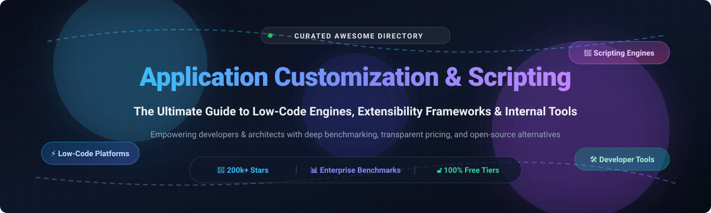
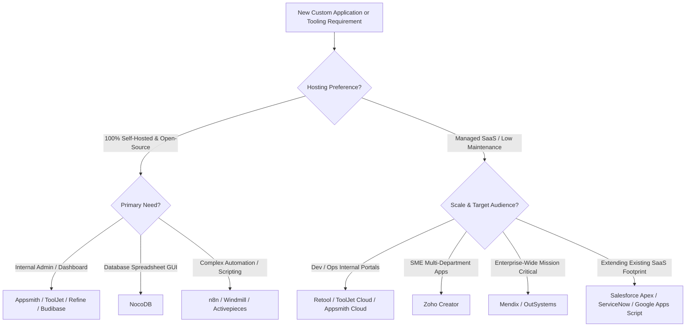

  

# 🚀 Awesome Application Customization & Scripting ⚡

> **A curated, battle-tested directory of low-code development platforms (LCAP), internal tool builders, extensibility engines, and platform scripting runtimes for software engineers, solution architects, and engineering leaders.**

  
  
  
  
  
  

---

  <a href="#-sector-overview--market-dynamics"><b>Sector Overview</b></a> •
  <a href="#-open-source-platforms--developer-frameworks"><b>Open-Source Platforms</b></a> •
  <a href="#-saas-customization--commercial-platforms"><b>SaaS & Commercial Platforms</b></a> •
  <a href="#-key-selection-criteria--decision-framework"><b>Decision Framework</b></a> •
  <a href="#-star-history"><b>Star History</b></a> •
  <a href="#-contributing--support"><b>Contributing & Support</b></a>

---

## 🌐 Sector Overview & Market Dynamics

The **Low-Code Application Development Platform (LCAP)** and internal tool builder sector is projected to reach between **$26 billion and $50 billion globally**, expanding at an aggressive CAGR exceeding **20% to 30%**. Driven by legacy modernizations, agile engineering demands, and cloud automation initiatives, the market is characterized by a **bifurcated structure**:

- 🏢 **Concentrated Enterprise Peak**: A tight cluster of monolithic platforms (**Microsoft Power Platform**, **Salesforce**, **ServiceNow**, **Siemens Mendix**, and **OutSystems**) captures heavy enterprise multi-year deals through deep cloud bundling, IT governance, and compliance capabilities.
- ⚡ **Highly Fragmented Developer & Open-Source Tier**: Rather than consolidating into a single winner-take-all monopoly, the developer and departmental tier remains vibrantly fragmented. Open-source innovators (**n8n**, **NocoDB**, **ToolJet**, **Appsmith**, **Refine**, **Windmill**) and agile proprietary builders (**Retool**) vigorously compete across developer experience (DX), self-hosting flexibility, Git-sync workflows, and transparent usage pricing.

---

## 💻 Open-Source Platforms & Developer Frameworks

This table catalogs standout open-source application platforms, workflow scripting systems, and developer-centric internal tooling suites. The entries are **sorted in descending order by GitHub stargazer count**.

| Project & Repository | GitHub Stars | License | Self-Hosted / Free Tier Limits | Core Technology Stack & Key Highlights |
| :--- | :---: | :---: | :--- | :--- |
| **[n8n](https://github.com/n8n-io/n8n)** |  | Fair-code (Sustainable) | **100% Free self-hosted**; unlimited workflow executions, unlimited custom nodes, full local code execution. Cloud plan starts at €20/month (2.5k executions). | Node-based workflow automation and backend scripting platform with 400+ native integrations and JavaScript/Python support. |
| **[NocoDB](https://github.com/nocodb/nocodb)** |  | AGPL-3.0 | **100% Free self-hosted**; unlimited bases, tables, records, and team members when running locally via Docker or Node. Hosted cloud plan starts at $10/user/month. | Open-source Airtable alternative that turns any relational database (MySQL, PostgreSQL, SQL Server, SQLite) into an intelligent spreadsheet and custom API backend. |
| **[ToolJet](https://github.com/ToolJet/ToolJet)** |  | AGPL-3.0 | **100% Free self-hosted** Community Edition. Cloud Free plan offers up to **2 builders, 50 end-users, unlimited apps**, and 100 AI credits/mo. Cloud Starter begins at **$24/builder/month**. | Full-featured low-code framework to build internal tools, database GUIs, and portals with JavaScript/Python transformations and Model Context Protocol (MCP) support. |
| **[Appsmith](https://github.com/appsmithorg/appsmith)** |  | Apache 2.0 | **100% Free self-hosted** Community Edition with unlimited users and apps. Managed Cloud Free tier allows up to **5 users and unlimited apps**. Business plan starts at **$15/user/month**. | Powerful UI drag-and-drop builder with native JavaScript scripting for building custom internal applications, admin panels, and CRUD portals. |
| **[Refine](https://github.com/refinedev/refine)** |  | MIT | **100% Free & Open Source forever** (MIT license). Commercial Enterprise support and SLA packages available on request. | React-based meta-framework for rapid development of internal tools, admin panels, B2B dashboards, and storefronts with headless flexibility. |
| **[Budibase](https://github.com/budibase/budibase)** |  | GPL-3.0 | **Free self-hosted plan** allows up to **5 internal users and 5 apps**. Cloud Free includes 5 users and 5 apps. Premium paid tier starts at **$5/user/month** (annual). | Fast all-in-one low-code internal tool platform that combines built-in tables, external DB integrations, and automated business workflows. |
| **[Activepieces](https://github.com/activepieces/activepieces)** |  | MIT | **100% Free self-hosted** Community Edition with unlimited tasks and active flows. Managed Cloud tier offers 1,000 tasks/month free; Starter tier begins at **$15/month** (10k tasks). | Modern, TypeScript-first workflow automation platform and open-source Zapier alternative designed for self-hosters and AI-agent scripting. |
| **[Windmill](https://github.com/windmill-labs/windmill)** |  | AGPL-3.0 | **Free self-hosted Community Edition** with unlimited scripts, flows, and apps. Cloud Free provides 5 users and 200 runs/month; Team plan starts at **$25/user/month**. | High-performance developer platform that turns scripts (Python, TypeScript, Go, Bash, SQL) into internal UIs, background workers, and automated enterprise flows. |
| **[ILLA Builder](https://github.com/illa-family/illa-builder)** |  | Apache 2.0 | **100% Free self-hosted** (unlimited users and apps via Docker/K8s). Cloud Free tier includes up to 5 team members and 1,000 Colla credits. Paid plans scale from **$15/seat/month**. | Robust open-source low-code internal tool builder with real-time multiplayer collaboration, AI agent integrations, and flexible chart components. |
| **[Lowdefy](https://github.com/lowdefy/lowdefy)** |  | Apache 2.0 | **100% Free & Open Source forever** (Apache 2.0). Unlimited local and self-hosted instances with no licensing restrictions. | Config-driven internal tool development engine where apps, layouts, state, and API integrations are defined entirely in YAML or JSON. |

---

## 🏢 SaaS Customization & Commercial Platforms

The table below catalogs premier commercial SaaS products, enterprise application builders, and platform-native scripting runtimes. The entries are **sorted in descending order by vendor company size (market capitalization, valuation, or ARR)**.

| Product / Vendor | Company Size (Market Cap / Valuation / ARR) | Starting Pricing (Paid Tier) | Free Tier / Trial Limits | Category & Key Capabilities |
| :--- | :--- | :--- | :--- | :--- |
| **[Google Apps Script](https://developers.google.com/apps-script)** (Alphabet Inc.) | **~$3.8 Trillion** (Market Cap) | **$6/user/month** (Google Workspace Business Starter) | **Free forever**: Personal Google accounts receive generous daily quotas (90 min/day trigger execution, 100 emails/day, 20 MB url fetch); Workspace unlocks 6 hrs/day trigger runtime & 1,500 emails/day. | Cloud-based JavaScript runtime for automating, extending, and orchestrating Google Workspace workflows. |
| **[Siemens Mendix](https://www.mendix.com/)** (Siemens AG) | **~$220 Billion** (Parent Market Cap; Acquired for **$730M**) | **€52.50/month** (Basic Tier, up to 5 users) or **$1,090/month** (Standard Single App) | **Free forever**: Free Community Edition supporting up to 10 named internal users, 1 GB storage, deployed on Mendix Free Cloud (sleeps after 1-2 hours of inactivity). | Model-driven enterprise low-code platform for full application lifecycle development. |
| **[Salesforce Apex](https://developer.salesforce.com/)** (Salesforce, Inc.) | **~$185 Billion** (Market Cap) | **$25/user/month** (Starter Suite; Enterprise at $165/user/month) | **Free forever**: Developer Edition org includes 2 full Salesforce user licenses, 5 MB data storage, 20 MB file storage, and 15,000 API calls/day (governed by multi-tenant transaction limits). | Strongly-typed, object-oriented back-end scripting language executed on the Lightning Platform. |
| **[ServiceNow App Engine](https://www.servicenow.com/products/app-engine.html)** (ServiceNow, Inc.) | **~$112 Billion** (Market Cap) | **~$35–$50/user/month** (Custom table fulfiller seat, annual multi-year contract) | **Free forever**: 1 Personal Developer Instance (PDI) with full App Engine Studio access; hibernates after 10 hours of inactivity, reclaimed if unused for 10 consecutive days. | Enterprise workflow and custom low-code app engine extending core IT and business services. |
| **[Zoho Creator](https://www.zoho.com/creator/)** (Zoho Corporation) | **~$12.5–$15 Billion** (Private Valuation; **$1.5B ARR**) | **$8/user/month** (Standard Tier, billed annually) or **$12/user/month** (monthly) | **Free forever**: 1 active application, 1 user (account owner), up to 5,000 records, and 250 MB file storage (preceded by a 15-day Professional trial). | Low-code application builder powered by Deluge scripting for custom business workflows and portals. |
| **[OutSystems](https://www.outsystems.com/)** | **~$4.3–$9.5 Billion** (Private Valuation; **~$250M+ ARR**) | **~$36,300/year** (~$3,025/month for OutSystems Cloud starting package) | **Free forever**: Personal Edition (1 cloud environment, up to 100 internal users, 1 GB database storage; non-production only, environments pause on inactivity). | Enterprise-grade high-performance low-code platform with native full-stack code generation. |
| **[Retool](https://retool.com/)** | **$3.2 Billion** (Private Valuation; **~$120M ARR**) | **$10/builder/month** + **$5/end-user/month** (Team plan, billed annually) | **Free forever**: Up to 5 users total (builders or viewers), unlimited apps, connecting to any database or REST/GraphQL API. | Leading visual builder with JavaScript scripting for internal operations tools and dashboards. |
| **[Appsmith Cloud](https://www.appsmith.com/)** | **~$250 Million** (Private Valuation; **$51.5M Funding**) | **$15/user/month** (Business Edition cloud / self-hosted) | **Free forever**: Cloud Free tier includes up to 5 users and unlimited apps with full UI drag-and-drop capabilities. | Managed cloud offering of the popular open-source internal tool building engine. |
| **[ToolJet Cloud](https://tooljet.com/)** | **~$30–$40 Million** (Est. Valuation; **$7.6M Funding**) | **$24/builder/month** (Starter Cloud plan) | **Free forever**: Cloud Free plan includes up to 2 builders, 50 end-users, and 100 AI credits/month. | Managed cloud edition of the extensible internal tool framework with native MCP server integration. |
| **[DronaHQ](https://www.dronahq.com/)** (Deltecs InfoTech) | **~$20–$30 Million** (Est. Valuation; **$1M Funding**, **~$10M ARR**) | **$10/user/month** or **$100/month** baseline starter cloud package | **30-day free trial**: 30-day unrestricted trial of the Business Plan (Free forever plan discontinued); 300 starter AI credits included during evaluation. | Drag-and-drop rapid application builder for enterprise micro-apps, forms, and automated business workflows. |

---

## 🎯 Key Selection Criteria & Decision Framework

When picking an application customization or low-code tool, consider the following primary architectural criteria:

1. **Deployment Architecture**:
   - *Self-Hosted*: Essential for strict data residency (HIPAA, GDPR, SOC 2). Look at **Appsmith**, **ToolJet**, **NocoDB**, or **Windmill**.
   - *Managed Cloud*: Drastically reduces maintenance overhead. Consider **Retool**, **Zoho Creator**, or **Mendix Cloud**.
2. **Developer Extensibility**:
   - Does your team require writing custom code? Choose platforms that treat JavaScript, TypeScript, or Python as first-class citizens (**Retool**, **Windmill**, **Activepieces**, **Refine**).
3. **Licensing & Cost Predictability**:
   - Beware per-end-user models if rolling out tools company-wide. Open-source self-hosted solutions or builder-only licensing models (**ToolJet**, **Retool** builder seats) minimize unexpected budget surges.

---

## 📈 Star History

---

## 💖 Contributing & Support

Thank you for visiting and supporting this project! If you found this repository helpful:
- ⭐ **Star** this repository to stay notified about new frameworks and platform updates!
- 🍴 **Fork** and submit a Pull Request to contribute additional customization platforms, benchmarks, or case studies.
- 📢 **Share** this list with colleagues, engineering communities, and fellow developers!

☕ If you'd like to support the ongoing maintenance and research of this repository, consider buying a coffee via the **[GitHub Sponsor Dashboard](https://github.com/sponsors/ishandutta2007)**:

  

---

  Part of the <a href="https://github.com/ishandutta2007/Awesome-Awesome-Awesome">Awesome-Awesome-Awesome</a> initiative. Distributed under the MIT License.

